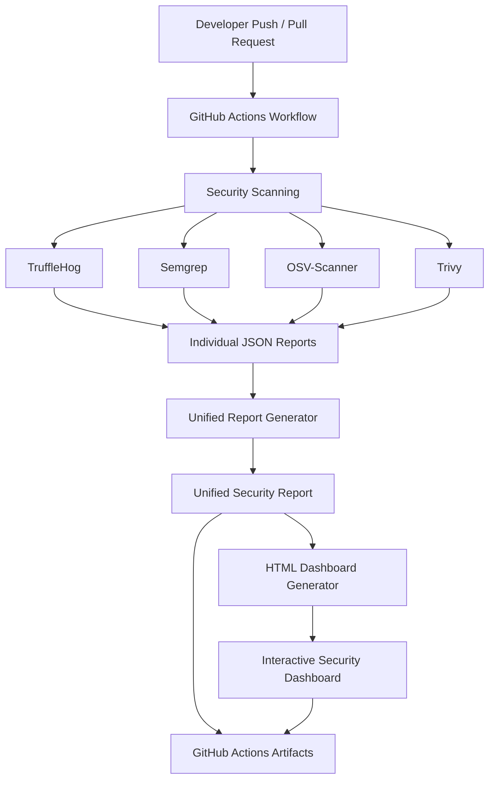
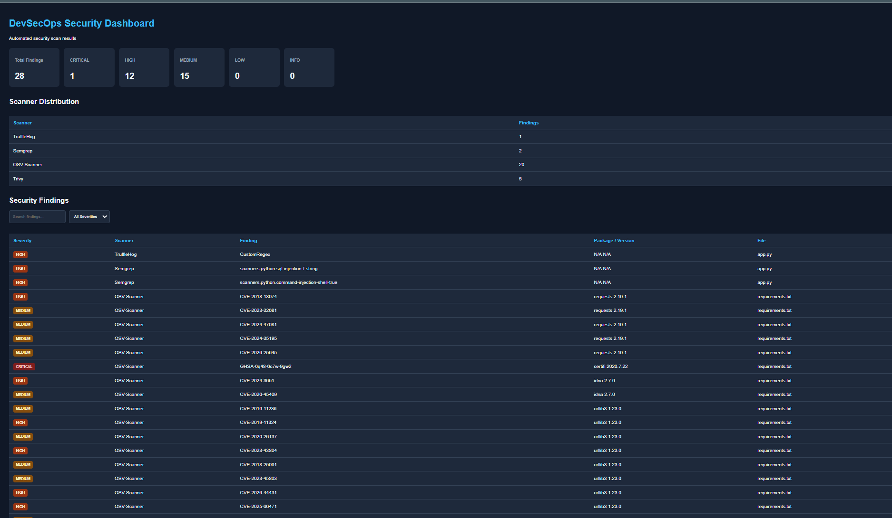

# 🛡️ Automated DevSecOps Security Pipeline

<p align="center">
  <strong>Automated security scanning • Vulnerability detection • Unified reporting</strong>
</p>

<p align="center">
  
  
  
  
</p>

<p align="center">
  <a href="https://github.com/dsr41/devsecops-security-pipeline/actions/workflows/security-pipeline.yml">
    
  </a>
</p>

## 📌 Overview

An automated **DevSecOps security pipeline** that integrates multiple open-source security tools into a GitHub Actions workflow to identify security weaknesses in application code, detect exposed secrets, and identify vulnerable dependencies.

The project combines scan results into a unified JSON report and generates an interactive HTML dashboard for centralized security visibility.

It demonstrates how security testing can be integrated into a CI/CD workflow to support continuous security assessment.

## ✨ Key Features

- **Secret Detection:** Identifies potentially exposed credentials and tokens using TruffleHog and a custom detector.
- **Static Application Security Testing (SAST):** Detects insecure coding patterns using Semgrep and custom security rules.
- **Dependency Vulnerability Scanning:** Identifies known vulnerabilities in project dependencies using OSV-Scanner.
- **Comprehensive Security Scanning:** Uses Trivy to scan for vulnerabilities, secrets, and supported misconfigurations.
- **Unified Reporting:** Normalizes findings from all scanners into a single JSON report.
- **Interactive Dashboard:** Displays findings, severity distribution, scanner statistics, and searchable results.
- **CI/CD Automation:** Automatically runs security scans on pushes and pull requests targeting the `main` branch, with manual execution also supported.
- **Artifact Storage:** Uploads generated reports as GitHub Actions artifacts.

## 🏗️ Architecture



## 🧰 Tools & Technologies

| Tool | Purpose |
|---|---|
| Python | Report processing and dashboard generation |
| GitHub Actions | CI/CD workflow automation |
| TruffleHog | Secret detection |
| Semgrep | Static application security testing |
| OSV-Scanner | Dependency vulnerability detection |
| Trivy | Vulnerability, secret, and misconfiguration scanning |
| HTML, CSS, JavaScript | Interactive security dashboard |
| Git & GitHub | Version control and project hosting |

## 📊 Sample Scan Results

The following results were generated during a successful GitHub Actions workflow execution.

| Severity | Findings |
|---|---:|
| Critical | 1 |
| High | 12 |
| Medium | 15 |
| Low | 0 |
| Informational | 0 |
| **Total** | **28** |

### Scanner Distribution

| Scanner | Findings |
|---|---:|
| TruffleHog | 1 |
| Semgrep | 2 |
| OSV-Scanner | 20 |
| Trivy | 5 |

*Note: These are results from a demonstration scan, not necessarily 28 unique underlying vulnerabilities. Different scanners can report overlapping issues. Counts may change as scanner versions, vulnerability databases, and project dependencies change.*

## 🖥️ Security Dashboard

The generated HTML dashboard provides a centralized view of the scan results, including:

- Total security findings
- Severity-wise distribution
- Scanner-wise finding counts
- Detailed findings table
- Search functionality
- Severity-based filtering

<p align="center">
  
</p>

## 📂 Project Structure

```text
devsecops-security-pipeline/
│
├── .github/
│   └── workflows/
│       └── security-pipeline.yml
│
├── sample-app/
│   └── app.py
│
├── scanners/
│   ├── run_osv.py
│   ├── semgrep-rules.yaml
│   └── trufflehog-config.yaml
│
├── scripts/
│   ├── generate_dashboard.py
│   ├── generate_report.py
│   └── run_semgrep.py
│
├── screenshots/
│   └── dashboard.png
│
├── .gitignore
├── README.md
└── requirements.txt
```

## ⚙️ How It Works

1. A developer pushes code to `main` or creates a pull request targeting `main`.
2. GitHub Actions starts the security pipeline.
3. TruffleHog scans for exposed secrets.
4. Semgrep analyzes application code using custom security rules.
5. OSV-Scanner checks project dependencies for known vulnerabilities.
6. Trivy scans for vulnerabilities, secrets, and supported misconfigurations.
7. Python scripts process the individual scanner reports.
8. Findings are consolidated into `unified-report.json`.
9. An interactive `security-dashboard.html` is generated.
10. Reports are uploaded as a downloadable GitHub Actions artifact.

The workflow can also be triggered manually using the GitHub Actions interface.

## 🚀 Running the Pipeline

1. Fork or clone this repository.
2. Open the repository on GitHub.
3. Navigate to the **Actions** tab.
4. Select **DevSecOps Security Pipeline**.
5. Trigger the workflow manually using **Run workflow**, or push a commit to `main`.
6. Open the completed workflow run.
7. Download the `devsecops-security-reports` artifact.
8. Extract the downloaded archive and open `security-dashboard.html` in a browser.

## 🔐 Security Considerations

This repository includes an intentionally vulnerable demonstration application to test security scanning capabilities.

- Demo credentials and tokens are fake placeholders, not production secrets.
- Vulnerable code is included for controlled security testing and demonstration.
- Do not use the sample application in a production environment.
- Do not add real credentials, API keys, or sensitive information to the repository.

## 🎯 Project Objectives

This project was developed to explore practical DevSecOps concepts, including:

- Integrating security tools into CI/CD pipelines.
- Automating source-code and dependency security assessments.
- Detecting exposed secrets and insecure coding patterns.
- Processing and normalizing security scanner output.
- Building centralized security reporting and visualization.

## 👨‍💻 Author

**Dushyant Singh Rathore**

- GitHub: [@dsr41](https://github.com/dsr41)
- LinkedIn: [dsr411](https://www.linkedin.com/in/dsr411/)

---

<p align="center">
  <strong>Built to demonstrate practical security automation and DevSecOps engineering.</strong>
</p>